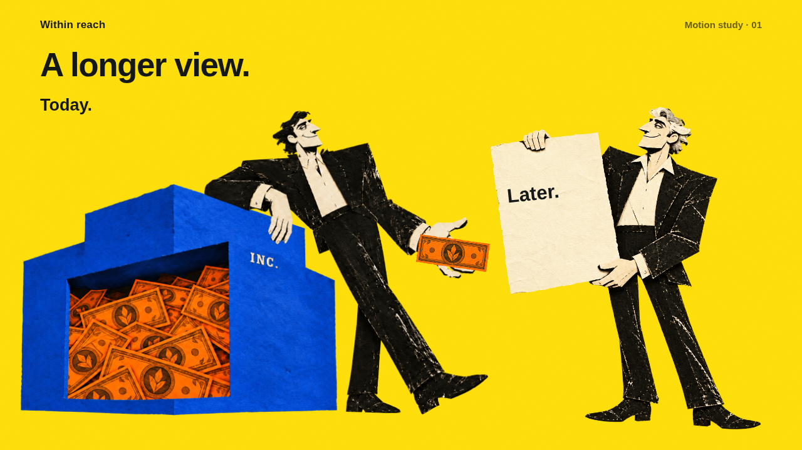

# fp-concepts

**Latest:** [The part before the handoff](video/projects/salary-dividend/README.md) — first-film visual argument, illustrated storyboard and a 14-second narrated passage. [Watch/download](https://github.com/itsbipolar/fp-concepts/raw/refs/heads/codex-video/video/projects/salary-dividend/review/salary-dividend-passage.mp4) · [See the storyboard](video/projects/salary-dividend/storyboard.png). Internal qualitative draft; official-source verification remains pending.

**Video branch:** [`codex-video`](https://github.com/itsbipolar/fp-concepts/tree/codex-video) carries Within reach into authored motion. [Review the nine-second study](video/README.md) · [Download the silent MP4](https://github.com/itsbipolar/fp-concepts/raw/refs/heads/codex-video/video/review/within-reach-motion-study.mp4). The existing paper artwork is the foundation; [the supplied motion kit](vendor/motion-kit/README.md) adds production guidance.

**Preserved interactive build:** [Salary or dividend](explorations/salary-or-dividend/README.md) — one payment changes tax treatment, the CPP earnings record and next year's RRSP room. [Download and try the visual prototype](https://github.com/itsbipolar/fp-concepts/raw/refs/heads/codex/explorations/salary-or-dividend/salary-or-dividend.zip). Quantified tax outcomes remain pending primary-source verification.

**Selected direction:** [Within reach](explorations/within-reach/README.md), the cut-paper treatment of company ownership, now has a working interaction. [Download and try it](https://github.com/itsbipolar/fp-concepts/raw/refs/heads/codex/explorations/within-reach/within-reach.zip). **The colossus** and **Separate bodies** remain in the [style-frame archive](explorations/style-frames/README.md) for possible future use. [Download all three style frames](https://github.com/itsbipolar/fp-concepts/raw/refs/heads/codex/explorations/style-frames/style-frames.zip).

## Editorial studio

The relevant work from [`fp-canada-vox-videos`](reference/vox-videos/README.md) now informs this branch: advanced Canadian planning for business-owner families and advisors, documentary questions and reveals, objects acting out the mechanism, linked evidence, and delivery records. Our Within reach artwork and positively reviewed motion study remain the visual foundation.

Start with the [editorial playbook](docs/VIDEO-EDITORIAL.md), [16 topic candidates](video/editorial/README.md), and [evidence/delivery workflow](docs/VIDEO-EVIDENCE.md). The transfer includes reusable [script](docs/templates/VIDEO-SCRIPT.md), [claims](docs/templates/VIDEO-CLAIMS.json) and [delivery](docs/templates/VIDEO-DELIVERY.json) templates. Original source files are pinned for reference; historical tax numbers and approvals are not inherited.

## Start a new chat

Attach this repository and use branch `codex-video` for video work (`codex` retains the interactive baseline). The repository's [AGENTS.md](AGENTS.md) is the entry point; [project state](docs/PROJECT-STATE.md) carries the compact handoff. A useful opening instruction is:

> Use the fp-video-build project skill on codex-video to build a short film about [financial concept]. Follow the existing Within reach artwork and video direction. Use the motion kit as an additive guide, develop the visual explanation from the financial relationships, and follow the lean model-routing workflow.

For unfinished work, replace “build [financial concept]” with “continue [lesson path] from its brief and project state.” A chat without repository access cannot retrieve this workflow automatically.

- [Video direction](docs/VIDEO-DIRECTION.md), [video workflow](docs/VIDEO-WORKFLOW.md), [video skill](.agents/skills/fp-video-build/SKILL.md) and [video brief template](docs/templates/VIDEO-BRIEF.md).
- [Drawing, texture and figure rules](docs/STYLE-SYSTEM.md), [reference assets](design/within-reach/asset-manifest.json) and [style tokens](design/within-reach/style-tokens.json).
- [Build phases and model routing](docs/BUILD-WORKFLOW.md), [interaction principles](docs/INTERACTION-PRINCIPLES.md) and [project skill](.agents/skills/fp-visual-build/SKILL.md).
- Templates for [lesson briefs](docs/templates/LESSON-BRIEF.md), [image prompts](docs/templates/IMAGE-PROMPT.md), [asset provenance](docs/templates/ASSET-RECORD.json) and [bounded agent tasks](docs/templates/AGENT-TASK.md).

Recommended main model for routine work: **Sol, medium**. Reserve **Astra high/ultra** for the difficult visual or causal decisions described in the routing guide. The app/user selects the main model; the workflow directs subagents where supported. It does not install or change model settings.

Check the portable kit with `python3 scripts/check_visual_system.py` (no dependencies beyond Python 3.9+). It checks references, hashes, palette anchors and local links; visual fidelity still needs screenshot review. New generated art uses the approved image references and saved prompts; reusing existing assets provides exact visual continuity.

## Historical concept-machine approach

The following records the earlier implementation. Its invented-machine workflow applies to legacy figures; use the current project skill for new work.

**Concept machines for Canadian financial planning.** Colourful, hand-inked isometric contraptions you can turn
around, look inside and operate, whose moving parts follow a real planning rule: the OAS clawback as a weir that
skims 15% of everything spilling over $95,323, an estate freeze as a block of ice with new shares sprouting from it,
death and taxes as a toll bridge with a spousal bypass lane. Made for client education and marketing in Canadian
wealth management.

Built on [Colorfigures](https://april-zhu.com/colorfigures) by April Zhu (MIT), which draws real machines (toasters,
claw machines) the same way.

## How it works
1. Pick a concept from the [catalog](docs/CONCEPT-CATALOG.md).
2. Write a brief: the rule, its numbers ([fact ledger](docs/FACT-LEDGER-2026.md)), the misconception, and the
   mapping from rule to machine ([metaphor grammar](.claude/skills/fp-figures/references/metaphor-grammar.md)).
3. Build the figure with the [fp-figures skill](.claude/skills/fp-figures/SKILL.md): one self-contained HTML page.
4. Verify it from every angle and check its numbers; run the [compliance checklist](docs/COMPLIANCE.md).
5. Export stills and a turntable clip for social ([pipeline](docs/PIPELINE.md)).

## Repo map
| Path | What |
|---|---|
| `CLAUDE.md` | project memory for Claude Code sessions |
| `.claude/skills/fp-figures/` | the skill, engine, kit and scripts |
| `docs/` | [vision](docs/VISION.md), [catalog](docs/CONCEPT-CATALOG.md), [facts](docs/FACT-LEDGER-2026.md), [sources](docs/SOURCES.md), [compliance](docs/COMPLIANCE.md), [brand](docs/BRAND.md), [pipeline](docs/PIPELINE.md), [roadmap](docs/ROADMAP.md), [decisions](docs/DECISIONS.md) |
| `figures/` | one folder per figure |
| `sources/` | versioned source material (v0: CFP crash notes) |
| `vendor/` | the original Colorfigures skill zip |

Figures are educational illustrations, not financial, tax or legal advice.
