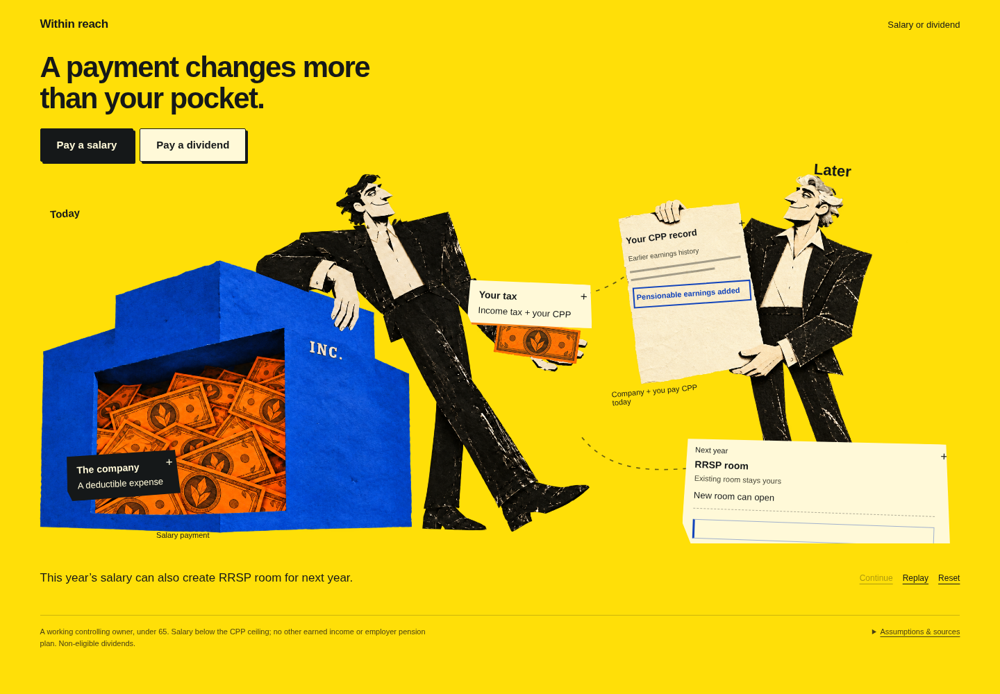
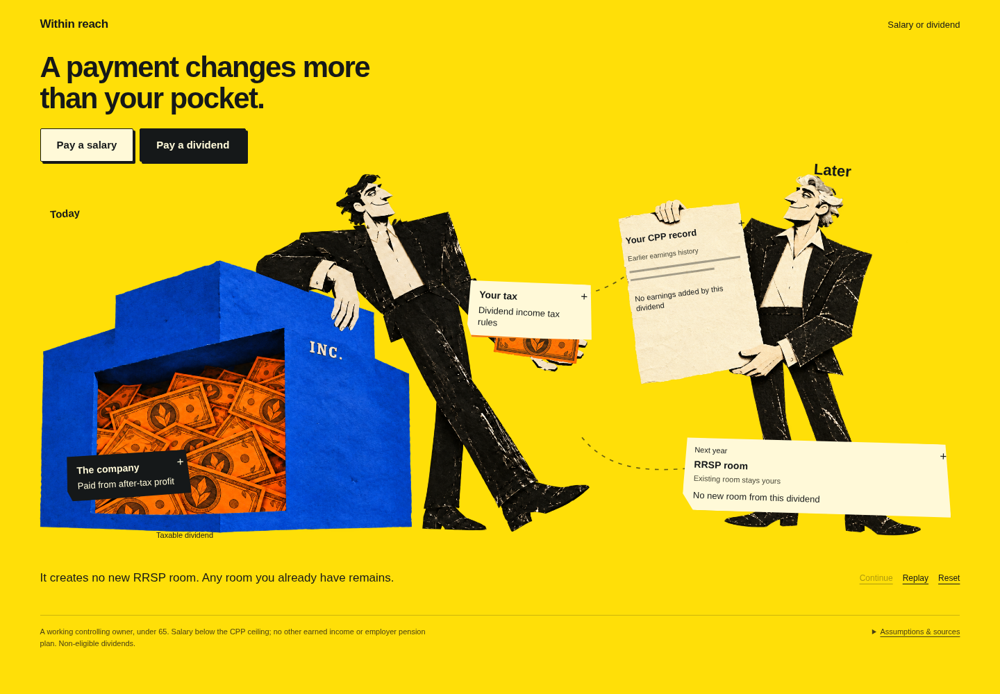

# Salary or dividend: what follows the payment

The first connected-consequence lesson in the **Within reach** style. Choose how the company pays its owner and watch what changes now, on the CPP record, and in next year's RRSP room.

**[Download the playable lesson](https://github.com/itsbipolar/fp-concepts/raw/refs/heads/codex/explorations/salary-or-dividend/salary-or-dividend.zip)** — extract the ZIP, then open **Salary or dividend.html** in a modern browser. Its artwork, styling and interaction are embedded. No server or installation is needed.


## What to try

1. Choose **Pay a salary**. The payment moves, company and personal tax labels change, two symbolic CPP contributions lead to an earnings mark, and a new RRSP room flap unfolds.
2. Choose **Pay a dividend**. The tax treatment changes; this dividend adds no CPP earnings or new RRSP room. Earlier history and existing room remain visible.
3. Tap an illustrated label for the explanation. Pause, replay, switch or reset whenever you like. Phone controls stay within reach while you scroll.

The older owner is one new reference-based illustration. Company, current owner and payment reuse the approved art; the original ownership prototype and two alternative styles are preserved.

## Financial scope

This is a **qualitative prototype**, with no tax rates, net-cash comparison or pension estimate. Notes, marks and paper sizes do not encode amounts. It assumes a working controlling shareholder under 65, pensionable salary below the annual CPP ceiling, no other earned income and no employer pension plan; the dividend is a lawfully declared non-eligible taxable dividend.

Official source sites were blocked by the environment, so numerical tax modeling remains pending. Domain additions for Canada.ca and Ontario.ca have been saved for review/save/publication in environment settings; they are not yet verified as applied. [Source notes and the next quantitative step](SOURCES.md).

## Settled scenes





## Validation

[Recorded checks](validation.json) passed: keyboard choice; pause/resume; rapid switching; reset during playback; replay; detail focus/Escape; reduced motion, including switching the preference while paused; 390px and 320px layouts; no JavaScript errors. Desktop and phone screenshots were visually inspected against the reference artwork. The protected reference kit still passes its integrity check.

The standalone HTML made only its own document request, with all four unique images embedded, and worked after network disconnection. ZIP integrity and exact HTML content passed. Managed Chromium blocks `file:` navigation, so direct file opening could not be tested in this cloud browser; the identical HTML was tested through a local server before disconnecting.

Rebuild and verify from the repository root:

```sh
python3 explorations/salary-or-dividend/package_review.py
python3 explorations/salary-or-dividend/verify.py
```

The verifier needs Python Playwright and Chromium. Edit `index.html`, `style.css`, `app.js` and `model.js`, not the generated `play.html`. Financial scope is in [the brief](BRIEF.md); the new asset's exact prompt and reference hashes are in [provenance](provenance/future-owner-request.json).
