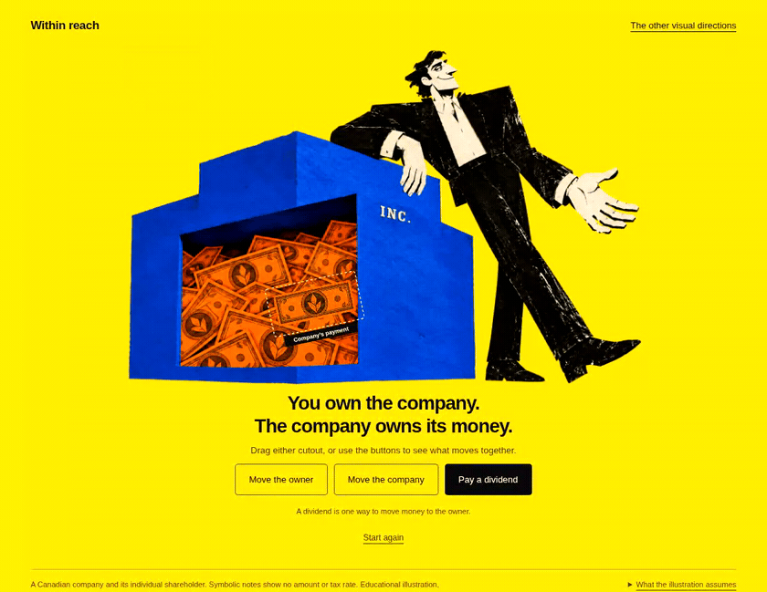

# Within reach

The selected cut-paper direction, now a working ownership interaction.

**[Download and try it](https://github.com/itsbipolar/fp-concepts/raw/refs/heads/codex/explorations/within-reach/within-reach.zip)** — extract the ZIP and open **Within reach.html** in a modern browser. Everything is embedded; no server or installation is needed.

## Explore

- **Move the owner:** company money stays put.
- **Move the company:** its notes move with it.
- **Pay a dividend:** the highlighted payment crosses to the owner. Move either cutout again to see where it now belongs.
- **Start again:** restore the original positions and ownership.

Drag the cutouts directly or use the buttons. Keyboard controls and reduced-motion settings are supported. One payment can be transferred per run.

## Scope

You own shares in the company; the company owns its cash. This example follows a lawfully declared taxable dividend from after-tax company funds to an individual shareholder. Personal tax may arise, and dividend tax credits help recognise corporate tax already paid. Other routes follow different rules. Symbolic notes show no amount or tax rate. Moving an illustration reveals grouping; it is not a legal transaction.

The interaction is a teaching prototype for review, not compliance-approved marketing material. See [the brief](BRIEF.md).

## Preserved alternatives

**[The colossus and Separate bodies remain in the style-frame archive](../style-frames/README.md)**, alongside the original Within reach still. All three original PNGs are unchanged.

## Files and provenance

- `index.html`: interactive page with local image assets.
- `play.html`: standalone page with embedded images.
- `within-reach.zip`: portable standalone page and opening instructions.
- `assets/`: generated transparent company, owner and payment layers derived from the selected frame using OpenAI image generation.
- `demo.gif`: browser recording of the interaction.
- `preview.png`: browser screenshot.
- `package_review.py`: regenerate the standalone HTML and ZIP after changes.

Verified in Chromium: ownership before/after payment, pointer dragging, keyboard actions, one-payment limit, interrupted transfer/reset, conflicting pointer/button input, mobile overflow, reduced motion, embedded images offline, and ZIP integrity. No JavaScript errors in the functional checks. Desktop and phone screenshots inspected.
