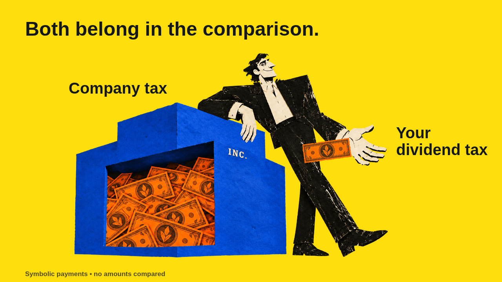

# The part before the handoff

**[Watch / download the 14-second passage](https://github.com/itsbipolar/fp-concepts/raw/refs/heads/codex-video/video/projects/salary-dividend/review/salary-dividend-passage.mp4)** · **[See the full-film storyboard](storyboard.png)** · [Storyboard PDF](https://github.com/itsbipolar/fp-concepts/raw/refs/heads/codex-video/video/projects/salary-dividend/storyboard.pdf)

The first film asks: **Why can a dividend feel cheaper than a salary?** It begins at the owner's hand, interrupts the payment, reveals the earlier company-tax event, and returns to the same handoff. The missing event changes how the opening image reads.

This delivery includes a visual argument, seven illustrated beats for the planned roughly 60-second film, and a finished 14-second representative passage with reused AI narration, captions and quiet paper sounds. The remaining film is storyboarded, not fully animated.



## Watch the edit

The payment stops short of the hand. “Before the dividend” takes us back to the company. A separate symbolic company-tax payment leaves the aperture and exits. “Then, the dividend” returns us to the original handoff; it completes, and the frame widens to leave both tax stages in view. Repeating the shot is an editorial revisit, not a second payment or a repayment.

The two spoken phrases are intact selections from your previous project's generated voice. They state the company-tax stage and the personal tax with a dividend tax credit. No old dollar comparison or categorical “only feels cheaper” kicker was carried over. Exact sources and edits are in [audio/provenance.json](audio/provenance.json); [SRT](captions.srt) and [VTT](captions.vtt) are included.

**Internal creative draft: financial research is pending.** Five official-source requests were blocked by the current environment. No amounts, rates, winner or tax equivalence are shown. Notes are symbolic, not measured proportions. The full comparison will need verified company/personal/payroll rules under a common company-cost basis. [Research status and request evidence](research/RESEARCH.md).

## Where the full film goes

The [illustrated storyboard](STORYBOARD.md) develops the reveal into a shared-cost salary comparison, then reaches later CPP earnings records and next-year RRSP room. Earlier rights remain in the dividend alternative. It uses the same paper drawing system without treating records, permission to contribute or pension rights as cash bags.

- [Visual argument and exact beat map](CREATIVE-DIRECTION.md).
- [Build brief, scope and model routing](BRIEF.md).
- [Provisional full-film script](SCRIPT.md).
- [Representative passage contact sheet](review/decoded-contact-sheet.png).
- [Visual review](review/VISUAL-REVIEW.md), [output checks](review/validation.json), [native playback report](review/playback.json) and [delivery record](delivery.json).

## Production checks

The MP4 is 1280×720, 30 fps, 420 frames / 14 seconds, H.264 with AAC audio. Checks cover exact source/output hashes, preserved artwork, key rendered frames, complete audio/video decoding and final hold. The actual decoded sequence and phone previews were inspected. Native Chromium playback reached the end; its report records any dropped frames. The audio has signal measurements and source-transcript alignment; no listening review or fresh financial verification is claimed. Rendering is not a TypeScript typecheck.

No new image or voice generation was needed. The original master, components, nine-second motion study and alternative style frames remain preserved. Three bounded delegates handled financial research (Sol), the hard visual argument (Astra high) and implementation (Sol); the main agent prepared the narrative, illustrated board, audio edits and delivery integration. No token savings estimate is claimed.

## Reproduce

From `video/`, after the existing `npm ci` setup:

```sh
npm run check:salary
npm run render:salary
npm run verify:salary
npm run storyboard:salary
```

The passage renderer restores its prepared audio from the committed `audio/passage.wav`; the previous full recording is not needed to rerender. The optional storyboard renderer uses the environment's Python Playwright and `/usr/bin/chromium`. Its editable source is [storyboard.html](storyboard.html). To rebuild audio edits from the pinned original recording, use `python3 tools/build-salary-audio.py --source /path/to/voice.wav`; the tool checks the original SHA-256 before editing. Audio analysis is in [measurements.json](audio/measurements.json).

This GitHub package is for review. It is not a public-platform posting or a completed factual/firm approval.
